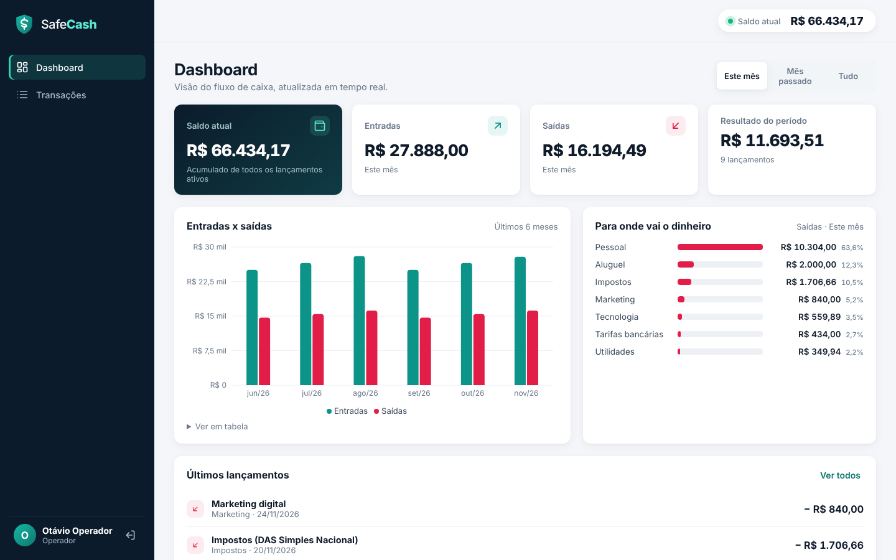
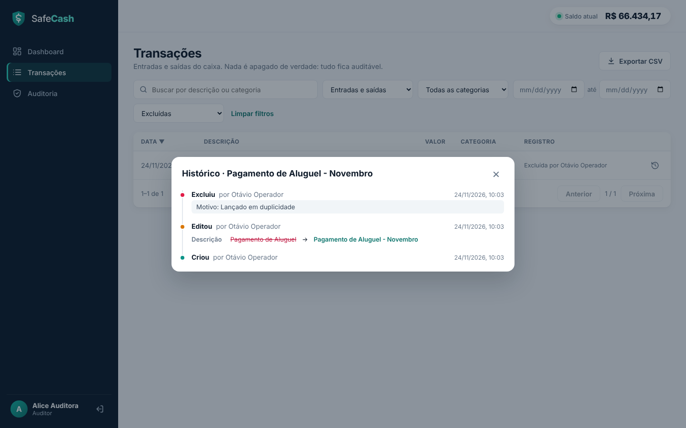
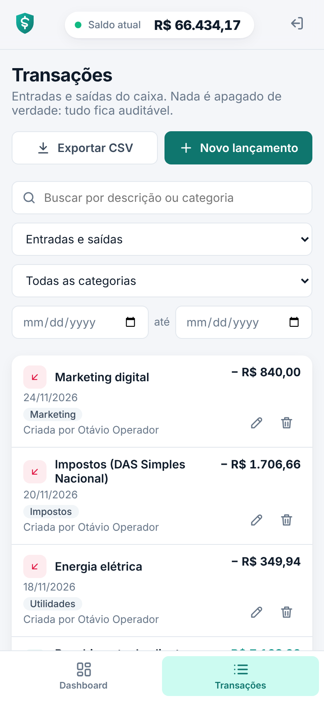

<p align="center">
  
</p>

<h1 align="center">SafeCash · Sistema de Tesouraria Integrada</h1>

<p align="center">
  Core Engine de fluxo de caixa com <strong>precisão bancária</strong>, <strong>trilha de auditoria completa</strong> e <strong>saldo em tempo real</strong>.<br/>
  Situação de Aprendizagem <em>FinTech Flow</em> · JavaScript Fullstack (Node.js + React)
</p>

<p align="center">
  
  
  
  
  
  
</p>

> 🔗 **Aplicação:** `https://SEU-PROJETO.vercel.app` · **API:** `https://SEU-SERVICO.onrender.com/api` · **Swagger:** `.../api/docs` · **Vídeo:** _link aqui_ (preencha após o deploy, veja [docs/08-deploy.md](docs/08-deploy.md))



## Sumário

- [O problema](#o-problema)
- [O que o sistema faz](#o-que-o-sistema-faz)
- [Como rodar](#como-rodar)
- [Rotas da API](#rotas-da-api)
- [Regras de integridade](#regras-de-integridade)
- [Arquitetura](#arquitetura)
- [Testes](#testes)
- [Documentação do projeto](#documentação-do-projeto)

## O problema

A **SafeCash**, startup de antecipação de recebíveis, controlava transações em sistemas legados que **permitiam lançamentos duplicados** e **não tinham trilha de auditoria**. Este projeto é o novo motor de tesouraria: toda operação passa por validação, fica registrada com autor e horário, e **nada é apagado de verdade**.

## O que o sistema faz

| | Funcionalidade |
|---|---|
| 💰 | **CRUD inteligente** de entradas e saídas com validação de esquema em todas as camadas |
| 🛡️ | **Soft delete (Regra de Ouro, H1):** excluir só marca o registro, com motivo; admin pode restaurar |
| 🔎 | **Trilha de auditoria:** quem criou, editou, excluiu e restaurou, quando, de qual IP, e o que mudou (antes → depois) |
| ⚡ | **Saldo em tempo real** em todas as telas, inclusive para outros usuários conectados (Server-Sent Events) |
| 📊 | **Dashboard** com saldo, entradas, saídas, resultado do período, gráfico mensal e gastos por categoria |
| 🧮 | **Valores em centavos inteiros:** zero erro de arredondamento |
| 🚫 | **Anti-duplicidade:** o mesmo envio (duplo clique, reenvio de rede) nunca cria dois lançamentos |
| 🔐 | **Login JWT + perfis (RBAC):** Administrador, Operador e Auditor |
| 🔍 | Busca, filtros (tipo, categoria, período, situação), ordenação e paginação |
| 📄 | Exportação de extrato em **CSV** (abre direto no Excel) |
| 📱 | **Multiplataforma:** no celular, menu inferior e tabela em cartões |

<table>
  <tr>
    <td width="68%"></td>
    <td></td>
  </tr>
  <tr>
    <td align="center"><sub>Histórico de uma transação excluída (visão do Auditor)</sub></td>
    <td align="center"><sub>Versão celular</sub></td>
  </tr>
</table>

## Como rodar

**Pré-requisitos:** [Node.js 22+](https://nodejs.org) e Git. Não precisa instalar banco de dados: em desenvolvimento a API usa SQLite em arquivo.

```bash
git clone https://github.com/SEU-USUARIO/safecash.git
cd safecash
```

**1. API** (terminal 1)

```bash
cd backend
npm install
cp .env.example .env        # no Windows (PowerShell): copy .env.example .env
npm run db:reset            # cria as tabelas e os dados de demonstração
npm run dev                 # http://localhost:3333  ·  Swagger: http://localhost:3333/api/docs
```

**2. Frontend** (terminal 2)

```bash
cd frontend
npm install
npm run dev                 # http://localhost:5173
```

**3. Entre com uma conta de demonstração** (também há botões na tela de login):

| Perfil | E-mail | Senha | Pode |
|---|---|---|---|
| Administrador | `admin@safecash.dev` | `Admin@123` | Tudo, inclusive restaurar e gerenciar usuários |
| Operador | `operador@safecash.dev` | `Operador@123` | Lançar, editar, excluir |
| Auditor | `auditor@safecash.dev` | `Auditor@123` | Só ler, ver excluídos e auditoria |

> Quer testar com PostgreSQL? `docker compose up --build` sobe banco + API iguais à produção.

### Scripts

| Pasta | Comando | O que faz |
|---|---|---|
| backend | `npm run dev` | API com recarga automática |
| backend | `npm start` | API em modo normal |
| backend | `npm test` | 28 testes (unitários + integração) |
| backend | `npm run db:migrate` / `db:rollback` / `db:seed` / `db:reset` | Gerencia o banco |
| frontend | `npm run dev` | Interface com recarga instantânea |
| frontend | `npm run build` | Build de produção em `dist/` |
| frontend | `npm run lint` | Verifica o padrão do código |
| frontend | `npm run test:e2e` | 6 testes de ponta a ponta (desktop + celular) |

## Rotas da API

Base: `/api` · Autenticação: `Authorization: Bearer <token>` · Documentação interativa: **`/api/docs`** (Swagger)

| Método | Rota | Descrição | Permissão |
|---|---|---|---|
| `GET` | `/health` | Status da API e do banco | pública |
| `POST` | `/auth/login` | Login → `{ token, user }` | pública |
| `GET` | `/auth/me` | Usuário logado e permissões | logado |
| `GET` | `/events` | Stream de tempo real (SSE) | logado |
| `GET` | `/transactions` | Listar com `page`, `limit`, `search`, `type`, `category`, `from`, `to`, `status`, `sort`, `order` | `transaction:read` |
| `GET` | `/transactions/categories` | Categorias em uso | `transaction:read` |
| `GET` | `/transactions/:id` | Detalhar | `transaction:read` |
| `POST` | `/transactions` | **Criar** (header opcional `Idempotency-Key`) | `transaction:create` |
| `PUT` | `/transactions/:id` | **Editar** (exige `version`) | `transaction:update` |
| `DELETE` | `/transactions/:id` | **Excluir (soft delete)**, body `{ reason }` opcional | `transaction:delete` |
| `PATCH` | `/transactions/:id/restore` | Restaurar excluída | `transaction:restore` |
| `GET` | `/transactions/:id/history` | Trilha de auditoria do registro | `audit:read` |
| `GET` | `/dashboard/summary` | Saldo atual + totais do período (`from`, `to`) | `transaction:read` |
| `GET` | `/dashboard/monthly` | Entradas × saídas por mês (`months`) | `transaction:read` |
| `GET` | `/dashboard/categories` | Total por categoria (`type`, `from`, `to`) | `transaction:read` |
| `GET` | `/reports/transactions.csv` | Extrato em CSV | `report:read` |
| `GET` | `/audit` | Auditoria geral (`entity`, `action`, `userId`) | `audit:read` |
| `GET` `POST` | `/users` | Listar / criar usuários | `user:manage` |
| `PATCH` | `/users/:id` | Mudar nome, perfil ou ativar/desativar | `user:manage` |

### Exemplo: "Pagamento de Aluguel – R$ 2.000,00"

```http
POST /api/transactions
Authorization: Bearer eyJhbGciOi...
Idempotency-Key: 3f1c2b7e-5d8a-4c11-9a0e-2b6f7d9e1a44
Content-Type: application/json

{ "description": "Pagamento de Aluguel", "amount": "2000.00", "type": "EXPENSE", "category": "Aluguel", "date": "2026-11-05" }
```

```json
201 Created
{
  "data": {
    "id": 60, "description": "Pagamento de Aluguel",
    "amount": "2000.00", "amountCents": 200000, "type": "EXPENSE",
    "category": "Aluguel", "date": "2026-11-05", "version": 1, "isDeleted": false,
    "createdAt": "2026-11-24T12:00:00.000Z", "createdBy": { "id": 2, "name": "Otávio Operador" },
    "updatedAt": null, "updatedBy": null, "deletedAt": null, "deletedBy": null
  }
}
```

### Formato padrão de erro

```json
400 Bad Request
{
  "error": {
    "code": "VALIDATION_ERROR",
    "message": "Dados inválidos.",
    "details": [{ "field": "amount", "message": "O valor deve ser positivo. Use o tipo (entrada/saída) para indicar o sentido." }],
    "requestId": "6c1f0a9e-1b2c-4d5e-8f90-123456789abc"
  }
}
```

| Código | HTTP | Quando |
|---|---|---|
| `VALIDATION_ERROR` | 400 | Campo inválido (detalhes por campo) |
| `INVALID_JSON` | 400 | Corpo não é JSON |
| `INVALID_CREDENTIALS` | 401 | E-mail ou senha errados |
| `INVALID_TOKEN` / `TOKEN_EXPIRED` | 401 | Token ruim ou vencido |
| `FORBIDDEN` | 403 | Perfil sem permissão |
| `NOT_FOUND` | 404 | Registro ou rota inexistente |
| `VERSION_CONFLICT` | 409 | Outra pessoa editou antes |
| `ALREADY_DELETED` / `TRANSACTION_DELETED` / `NOT_DELETED` | 409 | Operação incompatível com a situação do registro |
| `TOO_MANY_ATTEMPTS` | 429 | Muitas tentativas de login erradas |

## Regras de integridade

1. **Regra de Ouro (H1):** não existe exclusão física. `DELETE` preenche `deleted_at` e `deleted_by`; o registro some do saldo e da listagem padrão, mas continua no banco e na auditoria.
2. **Dinheiro em centavos:** `"2000.00"` vira `200000` (inteiro) sem passar por ponto flutuante.
3. **Valor sempre positivo:** o sentido vem do `type`. Valor negativo, zero, com mais de 2 casas ou acima de R$ 10 milhões é recusado pela API (Zod) **e** pelo banco (`CHECK`).
4. **Rastreabilidade:** `created_by/at`, `updated_by/at`, `deleted_by/at` em cada transação + tabela `audit_logs` (antes/depois em JSON, motivo, IP, request id).
5. **Atomicidade:** a alteração e a linha de auditoria são gravadas na mesma transação do banco.
6. **Anti-duplicidade:** `Idempotency-Key` com índice `UNIQUE`; o frontend gera uma chave por formulário aberto.
7. **Sem sobrescrita silenciosa:** edição exige a `version` lida; versão desatualizada → `409`.
8. **Esquema estrito:** campos desconhecidos (como `created_by`) são recusados.

## Arquitetura

```
frontend (React + Vite)  ──HTTPS + JWT──▶  backend (Express 5)  ──Knex──▶  SQLite (dev) / PostgreSQL (prod)
        ▲                                      │
        └────────── SSE: transactions:changed ─┘
```

```
backend/src
├── app.js · server.js
├── config/          env.js, permissions.js (RBAC)
├── database/        migrations/, seeds/, connection.js, cli.js
├── middlewares/     authenticate, authorize, validate, errorHandler, requestId
├── modules/         auth/ transactions/ dashboard/ reports/ audit/ users/
│                    (routes → service → repository)
├── realtime/        events.js (SSE)
├── utils/           AppError, money, dates
└── docs/openapi.yaml

frontend/src
├── components/      Logo, AppLayout, Modal, TransactionForm/Table/Filters, charts/...
├── contexts/        AuthContext, BalanceContext (saldo ao vivo)
├── hooks/           useDebounce, useDataChanged
├── pages/           Login, Dashboard, Transações, Auditoria, Usuários
├── services/        api.js, realtime.js
└── utils/           format.js
```

Diagramas (componentes, modelo ER e sequência) em [docs/02-arquitetura.md](docs/02-arquitetura.md).

## Testes

```bash
cd backend && npm test                 # 28 testes, SQLite em memória (~4 s)
DB_CLIENT=pg DATABASE_URL=postgres://... npm test   # mesmos testes no PostgreSQL
cd frontend && npm run test:e2e        # 6 testes Playwright (precisa da API rodando)
```

O GitHub Actions ([ci.yml](.github/workflows/ci.yml)) roda os testes no SQLite **e** no PostgreSQL, mais lint e build do frontend, a cada push e pull request.

## Documentação do projeto

| Documento | Etapa | Conteúdo |
|---|---|---|
| [01 · Requisitos](docs/01-requisitos.md) | 1 | RF, RNF, regras de negócio, mapa das habilidades H1–H10 e C10 |
| [02 · Arquitetura](docs/02-arquitetura.md) | 2 | Pastas, camadas, modelo de dados, fluxos, decisões |
| [03 · Justificativa da stack](docs/03-justificativa-stack.md) | H2–H4 | Por que JavaScript/Node para a SafeCash |
| [04 · Cronograma de sprints](docs/04-cronograma-sprints.md) | H8 | 11 etapas, definição de pronto, Git flow, conflitos · [CSV para o Trello](docs/trello-import.csv) |
| [05 · Segurança e RBAC](docs/05-seguranca-rbac.md) | 5 | Matriz de permissões e defesas |
| [06 · Desempenho](docs/06-desempenho.md) | 7, 9 | Índices e medições com 100 mil registros |
| [07 · Testes e homologação](docs/07-testes.md) | 8, 9 | Estratégia de testes e checklist de UX |
| [08 · Deploy e handover](docs/08-deploy.md) | 10 | Render, Vercel/Netlify, Docker, variáveis |
| [09 · Roteiro do vídeo](docs/09-roteiro-video.md) | 11 | Cena a cena, quem fala o quê |

## Equipe

| Nome | Papel principal | GitHub |
|---|---|---|
| _Integrante 1_ | Backend | @usuario |
| _Integrante 2_ | Frontend | @usuario |
| _Integrante 3_ | Gestão / QA | @usuario |

**Professor orientador:** Willer Barros

## Referências

- GRONER, Loiane. *Estruturas de Dados e Algoritmos com JavaScript*. 2. ed. Novatec, 2018.
- MARTIN, Robert C. *Código Limpo*. Alta Books, 2009.
- FREEMAN, Eric; ROBSON, Elisabeth. *Use a Cabeça! Programação em JavaScript*. Alta Books, 2016.
- CANTELON, Mike et al. *Node.js em Ação*. Novatec, 2014.
