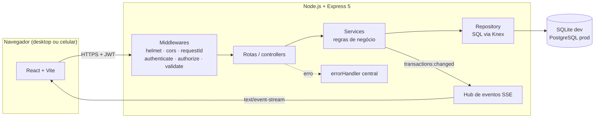
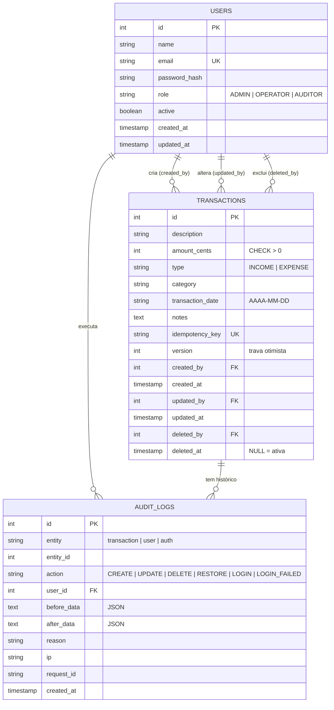
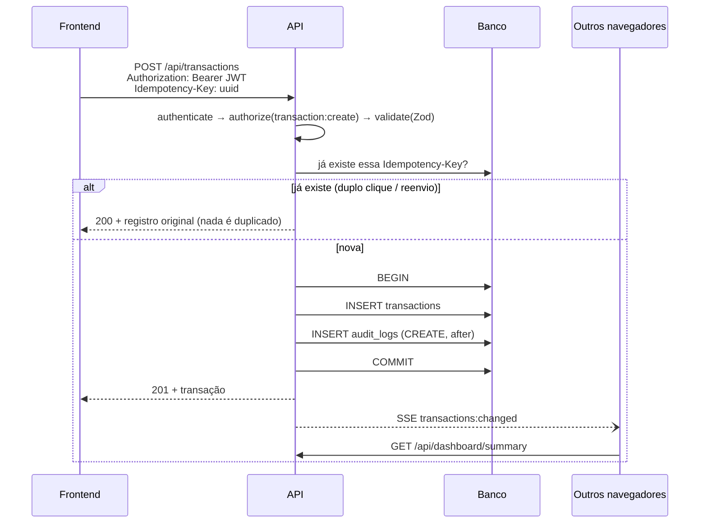

# 02 · Arquitetura (Etapa 2)

## Visão geral



### Por que em camadas

| Camada | Responsabilidade | Não pode |
|---|---|---|
| **Rotas** (`*.routes.js`) | Ler a requisição já validada, chamar o service, escolher o status HTTP | Ter SQL ou regra de negócio |
| **Service** (`*.service.js`) | Regras: soft delete, trava otimista, idempotência, auditoria, avisar o SSE | Conhecer `req`/`res` |
| **Repository** (`*.repository.js`) | SQL e conversão linha do banco → objeto da API | Decidir regra de negócio |
| **Middlewares** | Segurança, validação, erros, rastreio | — |

Assim cada parte é testável e trocável: mudar de SQLite para PostgreSQL mexeu só na configuração do Knex.

## Estrutura de pastas

```
safecash/
├── backend/
│   ├── src/
│   │   ├── app.js                  # monta o Express (middlewares + rotas)
│   │   ├── server.js               # sobe o servidor, migrations e desligamento gracioso
│   │   ├── config/                 # env.js (variáveis), permissions.js (RBAC)
│   │   ├── database/
│   │   │   ├── migrations/         # versões do banco (users, transactions, audit_logs, índices)
│   │   │   ├── seeds/              # dados de demonstração
│   │   │   ├── connection.js       # instância única do Knex
│   │   │   └── cli.js              # npm run db:migrate | db:seed | db:reset
│   │   ├── middlewares/            # authenticate, authorize, validate, errorHandler, requestId
│   │   ├── modules/                # um módulo por domínio
│   │   │   ├── auth/  transactions/  dashboard/  reports/  audit/  users/
│   │   ├── realtime/events.js      # Server-Sent Events (saldo em tempo real)
│   │   ├── utils/                  # AppError, money (centavos), dates
│   │   └── docs/openapi.yaml       # documentação Swagger
│   └── tests/                      # Vitest + Supertest
├── frontend/
│   ├── src/
│   │   ├── components/             # Logo, Modal, Table, Form, Filters, charts/...
│   │   ├── contexts/               # AuthContext (sessão), BalanceContext (saldo ao vivo)
│   │   ├── hooks/                  # useDebounce, useDataChanged
│   │   ├── pages/                  # Login, Dashboard, Transações, Auditoria, Usuários
│   │   ├── services/               # api.js (HTTP), realtime.js (SSE)
│   │   ├── utils/format.js         # moeda, datas, máscara de valor
│   │   └── styles/global.css
│   └── e2e/                        # Playwright (desktop + celular)
├── docs/                           # este material
└── .github/workflows/ci.yml        # testes e build a cada push
```

## Modelo de dados



## Fluxo de uma criação de transação



## Decisões técnicas (ADR resumido)

| Decisão | Alternativa descartada | Motivo |
|---|---|---|
| Centavos inteiros | `FLOAT`/`DECIMAL` em JS | `0.1 + 0.2 = 0.30000000000000004` em ponto flutuante |
| Knex (query builder) | ORM pesado (Prisma/Sequelize) | SQL visível para estudar; migrations; troca SQLite ↔ PostgreSQL sem mudar código |
| SSE para tempo real | WebSocket / polling | Só o servidor precisa falar; SSE é HTTP puro, reconecta sozinho e atravessa proxies |
| Trava otimista (`version`) | Lock no banco | Sem travar linhas; conflito vira mensagem clara para o usuário |
| Idempotency-Key | Checar "mesma descrição e valor" | Dois aluguéis iguais no mesmo dia podem ser legítimos; a chave identifica o *envio*, não o conteúdo |
| RBAC por permissão | `if (role === 'ADMIN')` espalhado | Criar um perfil novo não exige mexer em rotas |
